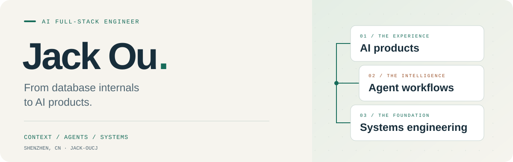
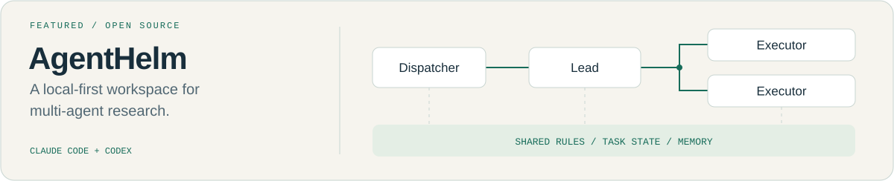

<picture>
  <source media="(prefers-color-scheme: dark)" srcset="assets/header-dark.svg" />
  <source media="(prefers-color-scheme: light)" srcset="assets/header-light.svg" />
  
</picture>

  <strong>I build AI products, the agents behind them, and the systems underneath.</strong>

  <a href="https://github.com/Jack-OuCJ/AgentHelm">AgentHelm</a>
  &nbsp; / &nbsp;
  <a href="https://github.com/Jack-OuCJ/ResearchMind">ResearchMind</a>
  &nbsp; / &nbsp;
  <a href="mailto:o760875296@gmail.com">Email</a>
  &nbsp; / &nbsp;
  <a href="https://x.com/Jack_OuCJ">X</a>

### Hi, I'm Jack · 欧聪杰

AI Full-Stack Engineer based in Shenzhen. I work across **Python backends, TypeScript interfaces, and agent workflows**, from the first design to deployment and debugging.

My background is in **database kernels and storage engines**. Today, I apply that systems experience to context engineering, LLM gateways, and AI applications.

### What I work on

- **AI products** — slide generation, interactive editing, preview, and PPTX export; error recovery for AI-generated applications.
- **Agent systems** — task orchestration, persistent working memory, tool integration, and research workflows.
- **LLM efficiency** — prompt caching, context reuse, multi-model gateways, and evaluation with observability and A/B experiments.
- **Systems engineering** — database internals, concurrency, resource control, and storage performance.

### Selected projects

<a href="https://github.com/Jack-OuCJ/AgentHelm">
  <picture>
    <source media="(prefers-color-scheme: dark)" srcset="assets/agenthelm-dark.svg" />
    <source media="(prefers-color-scheme: light)" srcset="assets/agenthelm-light.svg" />
    
  </picture>
</a>

| Project | What you'll find |
| :--- | :--- |
| [**AgentHelm**](https://github.com/Jack-OuCJ/AgentHelm) | A local-first research workspace for Claude Code and Codex. Layered agent coordination, shared task boards, and context that survives sessions. |
| [**ResearchMind**](https://github.com/Jack-OuCJ/ResearchMind) | An Agentic RAG research assistant built with LangGraph. Question decomposition, parallel research, hybrid retrieval, and source tracking. |
| [**Security portfolio**](https://github.com/Jack-OuCJ/security-portfolio) | Smart contract security training reports and DeFi challenge write-ups, with vulnerability analysis, proofs of concept, and mitigations. |

### Tools I use

| Area | Stack |
| :--- | :--- |
| AI & agents | Claude Code · Codex · LangGraph · LangChain · MCP · RAG |
| Backend | Python · FastAPI · Go · PostgreSQL · Redis |
| Interfaces | TypeScript · Vue · Nuxt · React · Flutter |
| Systems & delivery | C/C++ · Linux · Docker · Grafana · PostHog |

  
<strong>Earlier chapters: databases, secure messaging, and Web3</strong>

- **Database engineering** — worked on GaussDB Oracle compatibility, including nested subprograms and cross-package parameter cursors; multi-tenant IO control; and RocksDB compression strategies.
- **Cross-platform messaging** — built AI conversation features, Signal Protocol end-to-end encryption, and Web3Auth integration across iOS, Android, Windows, and macOS.
- **Security research** — explored DeFi vulnerabilities and built a [ZK mixer prototype](https://github.com/Jack-OuCJ/zk-mixer-ou) with Noir and UltraHonk.
- **Education** — B.Eng. in Electronic Information Engineering, Shenzhen University.

 

Understand the internals. Build the whole product. Measure what changes.

